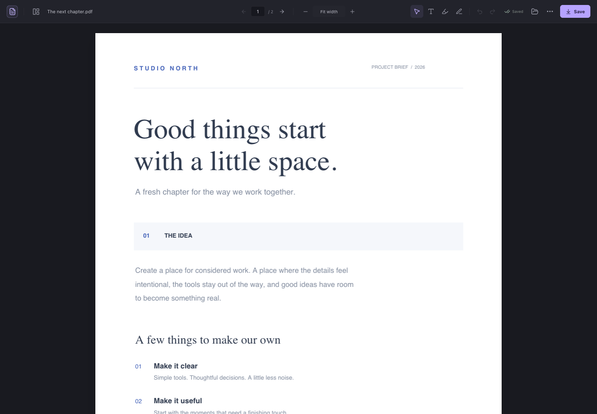
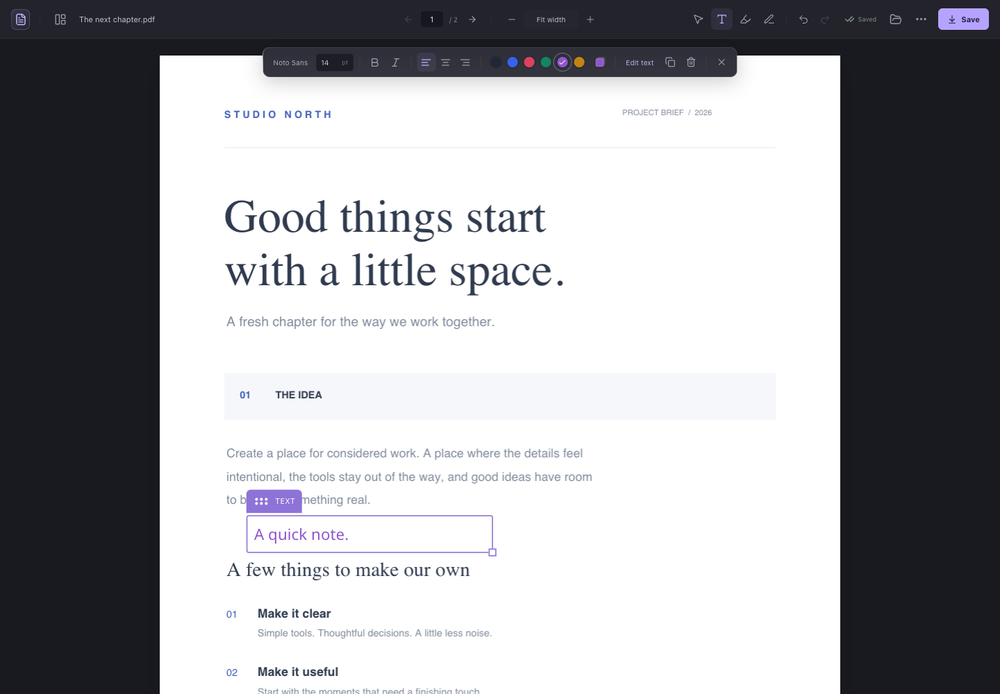

<div align="center">
  

  <h1>paperline</h1>

  <p>A quiet home for your PDFs.<br>Read, copy text, add notes, and save—all in your browser.</p>

  <p>
    <a href="https://github.com/dk-e/paperline/releases/latest"><strong>Download paperline</strong></a>
    · <a href="#install">Install</a>
    · <a href="#use-it">How it works</a>
    · <a href="PRIVACY.md">Privacy</a>
  </p>

  <p>
    <a href="https://github.com/dk-e/paperline/actions/workflows/ci.yml"></a>
    <a href="https://github.com/dk-e/paperline/releases/latest"></a>
    
  </p>
</div>



paperline is a PDF viewer and annotation editor for Chrome. Your document gets the space, with a compact toolbar and formatting controls that appear when you need them. No account, analytics, or cloud conversion service.

## What you can do

- **Read and copy naturally.** Drag across existing PDF text to select it, then copy with ⌘C / Ctrl+C or the right-click menu. No tool switch required.
- **Add a finishing touch.** Create text boxes, highlight areas, draw, and adjust fonts, colours, and alignment.
- **Keep your place.** PDF links open in a new editor tab, leaving the source page available. Signed-in Moodle PDF links keep their login context.
- **Save your work.** Export a separate annotated PDF. Reopen it in paperline to keep editing your annotations.
- **Pick up where you left off.** A local recovery draft remembers your latest document and edits.
- **Stay on your device.** Rendering, editing, and export happen locally. Online PDFs are requested from their original website.

## Install

**Chrome 128 or later.** paperline is distributed through GitHub Releases; it is not currently published on the Chrome Web Store.

1. Download **[paperline-1.4.0.zip](https://github.com/dk-e/paperline/releases/download/v1.4.0/paperline-1.4.0.zip)** from the [latest release](https://github.com/dk-e/paperline/releases/latest).
2. Unzip it and keep the extracted folder somewhere permanent.
3. Open `chrome://extensions` and turn on **Developer mode**.
4. Click **Load unpacked** and select the extracted **`dist`** folder.
5. Pin **paperline** from Chrome's extensions menu.

Click the toolbar icon, then choose **Open PDF**, drop in a file, or try the bundled sample.

For downloaded and local PDFs, enable **Allow access to file URLs** on paperline's extension details page. Allow site access for websites whose PDFs you want to open automatically.

### Updating an existing installation

Replace the existing installation's `dist` folder with the new one, then click **Reload** at `chrome://extensions` and reopen your PDF. Keep the same folder path to preserve the extension's identity and local draft.

Check **… → Paperline settings** for **1.4.0**. Reloading an old extracted folder keeps running its old code; make sure you replace the folder Chrome actually loads. The extension name and browser tab title are simply **paperline**.

## Use it

Drag across document text to select and copy it. Editing tools still allow text selection over existing PDF text; start a new text box or drawing in a blank area.

| Action | How |
| --- | --- |
| Add text | Press **T**, click a blank area, and type. Double-click a text box to edit it again. |
| Move or resize | Drag an annotation or its handle; use the lower-right corner to resize. |
| Format | Select a text box to change size, bold, italic, alignment, or colour. |
| Highlight | Press **H**, then drag a rectangle over the area you want to mark. |
| Draw | Press **D** and start drawing in a blank area. |
| Select annotations | Press **V**. Arrow keys nudge a selected mark; Shift + arrows move it further. |
| Undo / redo | **⌘/Ctrl + Z** / **⌘/Ctrl + Shift + Z** |
| Save PDF | **⌘/Ctrl + S** downloads a separate `-edited.pdf`. |
| Finish editing | Press **Esc**. |

Toggle page thumbnails beside the filename. Use the top bar to jump to a page or change zoom. The **…** menu contains keyboard shortcuts and settings.

<details>
<summary><strong>See the editing workspace</strong></summary>



</details>

### Automatic PDF opening

PDF links open in paperline automatically. Direct `.pdf` URLs, PDF response headers, local files, embedded PDFs, and completed PDF downloads are supported. Linked PDFs open in a new tab; embedded PDFs stay within their frame. Automatic links and downloads have separate switches in settings.

On signed-in websites such as Moodle, same-site PDF clicks are fetched in the website's own context, preserving login cookies and the original referrer. Moodle resource redirects and PDF embeds are resolved before transferring the document locally to the editor. The authenticated transfer path supports PDFs up to 128 MB; larger files can be opened manually.

Completed PDF downloads are kept. With local-file access enabled, paperline reads the downloaded file directly. Without it, HTTP downloads may be reopened from their source; protected or generated files may require local-file access or the file picker. Saving your own edited PDF does not open another tab.

If automatic opening fails, check site access and use **… → Paperline settings → Enable & repair automatic opening**, then refresh the source page. You can also open a PDF manually or use **Edit PDF in Paperline** from a link's context menu. Form submissions using POST are not redirected; download their PDF result instead.

## Privacy

Your PDFs and edits stay on your device. paperline has no account system, ads, analytics, or developer-operated document server. JavaScript, fonts, PDF decoders, and workers are bundled with the extension.

Online documents are fetched from their original website; Chrome may include your existing site cookies to load protected PDFs. A single recovery draft is stored locally in IndexedDB. You can delete it on the start screen. Removing the extension removes its local data; exported files remain yours.

Read the [privacy policy](PRIVACY.md) for storage, permissions, and network-request details.

## Scope

paperline adds annotations over existing PDF content. It does not rewrite original text, perform OCR, redact content, edit existing form fields, or unlock password-protected files. Scanned pages need an existing text layer for text selection and copying.

Saved annotations contain appearance streams and embedded fonts so other PDF readers can display them. paperline's own annotations remain editable when reopened. Noto Sans supports Latin, Greek, Cyrillic, and common symbols; unsupported characters produce an export error without discarding your work. Edit an unsigned copy of digitally signed documents.

## Development

Requires **Node.js 22+**, npm, and Python 3.

```sh
git clone https://github.com/dk-e/paperline.git
cd paperline
npm ci
npm run build
```

Load `dist/` as an unpacked extension. The build also creates:

- `release/paperline-1.4.0.zip` — manual installation, with a `dist/` folder.
- `release/paperline-1.4.0-chrome-web-store.zip` — store package, with the manifest at the ZIP root.

`npm run dev` runs the editor UI locally. Chrome permissions and automatic PDF handling require the actual extension build. `npm run assets` regenerates the sample PDF, icons, and rotation fixture.

### Tests

```sh
npx playwright install chromium
npm run build
npm test
```

The suite loads the extension in real Chromium and checks native text selection and clipboard paste, zoom and high-DPI alignment, cropped and rotated pages, editing and export, draft recovery, settings, and automatic PDF handling. Moodle fixtures exercise signed-in cookies, referrers, redirects, embeds, and multi-chunk transfer without accessing a real university account. A release test extracts the downloadable ZIP and checks installation and copying from that package.

GitHub Actions builds and tests each push to `main` and each pull request, and uploads release packages as workflow artifacts.

## Built with

[PDF.js](https://mozilla.github.io/pdf.js/) · [pdf-lib](https://pdf-lib.js.org/) · [React](https://react.dev/) · [Vite](https://vite.dev/) · [Lucide](https://lucide.dev/) · Noto Sans

Third-party notices ship in the extension's `THIRD-PARTY-LICENSES.txt` and font licence files.
